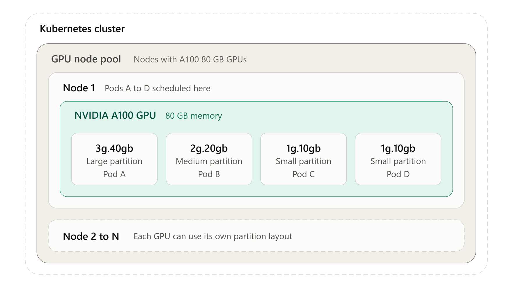

# Create a mixed strategy multi-instance GPU node pool in Azure Kubernetes Service (AKS) (preview)

Multi-instance GPU (MIG) divides a [compatible NVIDIA GPU](https://www.nvidia.com/en-us/technologies/multi-instance-gpu/) into partitions with dedicated compute and memory resources. In an AKS cluster, workloads request these partitions through Kubernetes extended resources. Use the mixed multi-instance GPU (MIG) strategy to match GPU partition sizes to your workloads. Instead of assigning an entire GPU to a smaller workload or using the same partition size for every workload, run workloads with different compute and memory needs on one GPU. Each partition has isolated compute and memory resources. This approach can improve GPU utilization by letting smaller workloads share GPU capacity alongside larger workloads.

For example, an NVIDIA A100 80 GB GPU can provide one large partition, one medium partition, and two small partitions. Four workloads can run concurrently, each using a partition sized for its needs, as shown in the following sample mixed layout.



This article shows how to create a mixed MIG node pool, verify partition allocation, and run sample workloads.

For strategy selection, see [Multi-instance GPU strategies in AKS](./multi-instance-gpu-overview.md). For uniform partitions, see [Create a single strategy MIG node pool](./gpu-multi-instance.md).

[!INCLUDE [preview features callout](~/reusable-content/ce-skilling/azure/includes/aks/includes/preview/preview-callout.md)]

## Before you begin

Before you configure a mixed MIG node pool, make sure you have the following prerequisites:

- This article assumes you have an existing AKS cluster. If you don't have a cluster, create one using the [Azure CLI](/cli/azure/install-azure-cli), Azure PowerShell, or the Azure portal.
- You installed Azure CLI with version `2.85.0` or later and the `aks-preview` extension version `22.0.0b15` or later. Run `az --version` to check your Azure CLI version.
- A [supported MIG-capable GPU VM size](./multi-instance-gpu-overview.md#supported-gpu-vm-sizes) available in your selected AKS region. Ensure that you have enough regional and GPU-family vCPU quota for the VM size and node count you plan to deploy.
- A compatible mixed MIG layout for your selected GPU. Choose supported partition profiles that satisfy the GPU's capacity and placement constraints. For details, see [Understand mixed MIG profiles](#understand-mixed-mig-profiles).
- The MIG node pool uses an AKS Linux node image based on VHD version `202609.01.0` or later.
- The `ManagedGPUExperiencePreview` and `MixedMIGStrategyPreview` features registered in your subscription. For instructions, see [Register the preview features](#register-the-preview-features).

## Limitations

- Node pools with `AzureContainerLinux` and `Windows` OS SKUs aren't currently supported with this feature.
- This feature doesn't currently support autoscaling of MIG nodes with mixed strategy by using [AKS cluster autoscaler](./cluster-autoscaler-overview.md).
- A mixed strategy configuration must satisfy the GPU's partitioning capacity and placement constraints.
- You can't change the profile configuration after MIG node pool creation. Create a replacement pool to change the layout or stop using MIG. Don't try to disable MIG by updating the strategy to `None`.

## Understand mixed MIG profiles

A _profile_, such as `MIG3g`, defines the size of one GPU partition. A _layout_ is the set of profiles that you configure on a node pool. Each profile in the layout creates one _partition_ that workloads request as an extended resource.

The MIG strategy controls both the compatible profile configuration and the resource names that workloads request.

| Strategy | Profile configuration | Workload resource |
| --- | --- | --- |
| **Single** | Specify exactly one profile, then AKS creates a uniform partition layout. | `nvidia.com/gpu`: Each unit represents one MIG partition, not the entire physical GPU. |
| **Mixed** | Specify one or more compatible profiles that form a supported layout. Repeat a profile to request multiple partitions of that size. | A profile-specific resource, such as `nvidia.com/mig-1g.10gb`. |

The supported profile values are `MIG1g`, `MIG2g`, `MIG3g`, `MIG4g`, and `MIG7g`. The following table shows the partition that each profile creates on an NVIDIA A100 80 GB GPU, such as the GPU in `Standard_NC24ads_A100_v4`. GPU memory per profile depends on the [NVIDIA GPU model](https://www.nvidia.com/en-us/technologies/multi-instance-gpu/).

| Profile | Compute slices | Partition | Workload resource |
| --- | --- | --- | --- |
| `MIG1g` | 1 | `1g.10gb` | `nvidia.com/mig-1g.10gb` |
| `MIG2g` | 2 | `2g.20gb` | `nvidia.com/mig-2g.20gb` |
| `MIG3g` | 3 | `3g.40gb` | `nvidia.com/mig-3g.40gb` |
| `MIG4g` | 4 | `4g.40gb` | `nvidia.com/mig-4g.40gb` |
| `MIG7g` | 7 | `7g.80gb` | `nvidia.com/mig-7g.80gb` |

## Prepare your environment

Set your environment variables, register the preview features, and connect to your existing cluster before you add the mixed MIG node pool.

### Set environment variables

1. Set the following environment variables for your existing cluster. The sample manifests later in this article use `migmixed` for `MIXED_POOL`.

   ```bash
   export SUBSCRIPTION_ID="<subscription-id>"
   export RESOURCE_GROUP="<my-resource-group>"
   export CLUSTER_NAME="<my-cluster-name>"
   export MIXED_POOL="<mig-pool-name>"
   ```

### Register the preview features

1. Install or update the `aks-preview` extension.

   ```azurecli
   az extension add --name aks-preview --upgrade --yes
   ```

1. Register the `ManagedGPUExperiencePreview` feature.

   ```azurecli
   az feature register \
     --namespace Microsoft.ContainerService \
     --name ManagedGPUExperiencePreview
   ```

1. Register the `MixedMIGStrategyPreview` feature.

   ```azurecli
   az feature register \
     --namespace Microsoft.ContainerService \
     --name MixedMIGStrategyPreview
   ```

1. Confirm the managed GPU feature registration state.

   ```azurecli
   az feature show \
     --namespace Microsoft.ContainerService \
     --name ManagedGPUExperiencePreview \
     --query properties.state --output tsv
   ```

1. Confirm the mixed MIG feature registration state.

   ```azurecli
   az feature show \
     --namespace Microsoft.ContainerService \
     --name MixedMIGStrategyPreview \
     --query properties.state --output tsv
   ```

1. After both states return `Registered`, refresh the resource provider registration.

   ```azurecli
   az provider register --namespace Microsoft.ContainerService
   ```

### Connect to your AKS cluster

1. Retrieve the cluster credentials.

   ```azurecli
   az aks get-credentials \
     --resource-group "$RESOURCE_GROUP" \
     --name "$CLUSTER_NAME"
   ```

1. Verify the connection and existing node status.

   ```bash
   kubectl get nodes
   ```

## Enable mixed MIG on a new node pool

Use the Azure CLI to create a mixed MIG node pool. Select the tab for your node OS SKU.

### [Ubuntu Linux node pool (default SKU)](#tab/add-ubuntu-gpu-node-pool)

To use the default OS SKU, create the node pool without specifying an OS SKU. The node pool is configured for the default operating system based on the Kubernetes version of the cluster.

Create a mixed MIG node pool by using the following A100 layout. Specify `--enable-managed-gpu=true`, `--gpu-mig-strategy Mixed`, and the MIG profile list together. AKS preserves the supplied list order and handles placement ordering during node configuration.

```azurecli
az aks nodepool add \
  --resource-group "$RESOURCE_GROUP" \
  --cluster-name "$CLUSTER_NAME" \
  --name "$MIXED_POOL" \
  --node-vm-size "Standard_NC24ads_A100_v4" \
  --enable-managed-gpu=true \
  --gpu-mig-strategy Mixed \
  --gpu-mig-profiles MIG3g MIG2g MIG1g MIG1g \
  --node-count 1
```

### [Azure Linux node pool](#tab/add-azure-linux-gpu-node-pool)

To use Azure Linux, specify the OS SKU by setting `os-sku` to `AzureLinux` during node pool creation. The `os-type` is set to `Linux` by default.

Create a mixed MIG node pool by using the following A100 layout. Specify `--enable-managed-gpu=true`, `--gpu-mig-strategy Mixed`, and the MIG profile list together. AKS preserves the list order you provide and handles placement ordering during node configuration.

```azurecli
az aks nodepool add \
  --resource-group "$RESOURCE_GROUP" \
  --cluster-name "$CLUSTER_NAME" \
  --name "$MIXED_POOL" \
  --node-vm-size "Standard_NC24ads_A100_v4" \
   --os-sku AzureLinux \
  --enable-managed-gpu=true \
  --gpu-mig-strategy Mixed \
  --gpu-mig-profiles MIG3g MIG2g MIG1g MIG1g \
  --node-count 1
```

---

## Verify the mixed MIG configuration

Verify the node pool configuration, node readiness, and advertised resources separately. Successful GPU node provisioning alone doesn't confirm that a workload can use a partition.

1. Inspect the pool configuration and node image.

   ```azurecli
   az aks nodepool show \
     --resource-group "$RESOURCE_GROUP" \
     --cluster-name "$CLUSTER_NAME" \
     --name "$MIXED_POOL" \
     --query "{state:provisioningState,image:nodeImageVersion,gpu:gpuProfile.nvidia}" \
     --output json
   ```

   Confirm that the output matches the following values:

   | Output field | Expected value |
   | --- | --- |
   | `state` | `Succeeded` |
   | `gpu.managementMode` | `Managed` |
   | `gpu.driverMode` | `DevicePlugin` |
   | `gpu.migStrategy` | `Mixed` |
   | `gpu.migProfiles` | `MIG3g`, `MIG2g`, `MIG1g`, `MIG1g` (both `MIG1g` entries) |

1. Wait for the nodes in the mixed MIG node pool to become `Ready`.

   ```bash
   kubectl wait --for=condition=Ready node \
     -l agentpool="$MIXED_POOL" --timeout=600s
   ```

1. Inspect the allocatable NVIDIA resources on every node in the pool.

   ```bash
    kubectl describe nodes -l agentpool="$MIXED_POOL"
   ```

    For `Standard_NC24ads_A100_v4` with the `MIG3g MIG2g MIG1g MIG1g` layout, each node's `Allocatable` section should include the following resource counts alongside its CPU, memory, and other resources:

    ```output
    Allocatable:
       nvidia.com/mig-1g.10gb:  2
       nvidia.com/mig-2g.20gb:  1
       nvidia.com/mig-3g.40gb:  1
   ```

   These counts are allocatable capacity, not a report of currently unused partitions. Inspect scheduled pod requests to determine remaining capacity.

## Run workloads on different partition sizes

Use the exact extended resource names that your nodes advertise. The following examples request one `3g.40gb` partition and one `1g.10gb` partition. Each container runs `nvidia-smi` once to report GPU device information, then exits.

1. Create a file named `mixed-mig-workloads.yaml` with the following manifest. The `agentpool` selectors use the `migmixed` pool name. If you used a different name for `MIXED_POOL`, update both selectors.

   ```yaml
   apiVersion: v1
   kind: Pod
   metadata:
     name: mixed-mig-pod-3g
   spec:
     restartPolicy: Never
     nodeSelector:
       agentpool: migmixed
     containers:
       - name: gpu-test
         image: mcr.microsoft.com/azuredocs/samples-tf-mnist-demo:gpu
         command: ["nvidia-smi"]
         resources:
           limits:
             nvidia.com/mig-3g.40gb: "1"
   ---
   apiVersion: v1
   kind: Pod
   metadata:
     name: mixed-mig-pod-1g
   spec:
     restartPolicy: Never
     nodeSelector:
       agentpool: migmixed
     containers:
       - name: gpu-test
         image: mcr.microsoft.com/azuredocs/samples-tf-mnist-demo:gpu
         command: ["nvidia-smi"]
         resources:
           limits:
             nvidia.com/mig-1g.10gb: "1"
   ```

   Kubernetes uses an extended resource limit as the request when you omit a separate request. Specify whole-number partition counts. If you set both requests and limits for the same GPU resource, use equal values.

1. Deploy the sample pods.

   ```bash
   kubectl apply -f mixed-mig-workloads.yaml
   ```

1. Wait for the larger-partition pod to complete successfully.

   ```bash
   kubectl wait --for=jsonpath='{.status.phase}'=Succeeded \
     pod/mixed-mig-pod-3g --timeout=300s
   ```

1. Wait for the smaller-partition pod to complete successfully.

   ```bash
   kubectl wait --for=jsonpath='{.status.phase}'=Succeeded \
     pod/mixed-mig-pod-1g --timeout=300s
   ```

1. Check the pods' node assignments.

   ```bash
   kubectl get pods mixed-mig-pod-3g mixed-mig-pod-1g -o wide
   ```

1. Read the larger-partition pod's GPU device information.

   ```bash
   kubectl logs mixed-mig-pod-3g
   ```

   Check that `nvidia-smi` reports the GPU and an assigned MIG device without errors. The pod requests the node's advertised `nvidia.com/mig-3g.40gb` resource.

1. Read the smaller-partition pod's GPU device information.

   ```bash
   kubectl logs mixed-mig-pod-1g
   ```

   Check that `nvidia-smi` reports the GPU and an assigned MIG device without errors. The pod requests the node's advertised `nvidia.com/mig-1g.10gb` resource. Output formatting depends on the driver version; the default command doesn't necessarily display profile names. Physical GPU information isn't evidence that the pod has access to the whole GPU.

   Successfully completed pods show `Completed` in `kubectl get pods`. They don't remain Ready or retain their partition allocation after the container exits. If a completion wait times out, inspect the pod's status, logs, and events to distinguish scheduling problems from image or container failures.

For a `Single` strategy pool, request `nvidia.com/gpu: "1"` instead of a profile-specific resource. Don't reuse that resource name to request a partition from the mixed pool in this example.

## Scale and maintain the node pool

Scaling preserves the mixed MIG node pool's original strategy and profile list. Ensure that you have quota and GPU capacity before adding nodes.

```azurecli
az aks nodepool scale \
  --resource-group "$RESOURCE_GROUP" \
  --cluster-name "$CLUSTER_NAME" \
  --name "$MIXED_POOL" \
  --node-count 2
```

Repeat the node readiness and allocatable resource checks for all nodes. With `Standard_NC24ads_A100_v4` and the `MIG3g MIG2g MIG1g MIG1g` layout, each node advertises the same four partitions: one `3g.40gb`, one `2g.20gb`, and two `1g.10gb`. More nodes add capacity for the configured partition types; they don't add missing types.

Update the node image by using the `node-image-only` upgrade command. Plan for workload disruption and replacement-node GPU quota and capacity during maintenance.

```azurecli
az aks nodepool upgrade \
  --resource-group "$RESOURCE_GROUP" \
  --cluster-name "$CLUSTER_NAME" \
  --name "$MIXED_POOL" \
  --node-image-only
```

## Optimize partition usage for production workload evaluation

Use the following practices to evaluate your production workload mix in an AKS test environment before planning a production deployment.

- **Size partitions from measurements.** Benchmark representative inference, batch, and training workloads. Measure peak device memory, compute utilization, throughput, and latency under realistic concurrency. Select the smallest partition that meets your workload requirements with memory headroom.
- **Match the layout to concurrent demand.** The `MIG3g MIG2g MIG1g MIG1g` layout on `Standard_NC24ads_A100_v4` provides one large, one medium, and two small partitions per node. Two simultaneous requests for a large partition need two nodes even if smaller partitions are idle. Choose layouts from the distribution of simultaneous demand, not just total GPU memory.
- **Treat capacity as separate resource types.** Track requested and available capacity for each `nvidia.com/mig-*` resource. Kubernetes doesn't combine small partitions into a larger one or resize the configured layout to satisfy a pending pod.
- **Use separate pools for different workload classes.** Keep workloads that need an unpartitioned GPU on a pool created without MIG settings. Use a uniform single strategy when all jobs need the same partition size, and mixed layouts when workloads need different sizes. Benchmark distributed or multi-GPU workloads separately rather than assuming they behave like full-GPU workloads.
- **Set CPU and memory requests as well as GPU limits.** An available GPU partition doesn't ensure that a node has enough host memory or CPU to run the workload. Use a Deployment or Job appropriate to your application's lifecycle rather than the inspection pods in this article.
- **Monitor workload outcomes and partition utilization together.** Compare latency, throughput, GPU memory pressure, and scheduling failures by MIG profile.
- **Validate your application stack.** Test framework, CUDA, driver, and partition compatibility. Pin validated application image versions or digests, and don't use the inspection image as a production application image.

## Troubleshoot configuration and scheduling

If a sample pod stays `Pending`, check its scheduling events and the node's allocated resources.

Inspect the scheduling events for a pending sample pod, such as `mixed-mig-pod-3g` from [Run workloads on different partition sizes](#run-workloads-on-different-partition-sizes):

```bash
kubectl describe pod mixed-mig-pod-3g
```

Inspect the allocated resource requests on the mixed MIG node pool's nodes:

```bash
kubectl describe nodes -l agentpool="$MIXED_POOL"
```

Common causes include:

- **The pod requests a resource the pool doesn't advertise.** For example, a request for `nvidia.com/mig-4g.40gb` stays pending on a pool created with `MIG3g MIG2g MIG1g MIG1g`, because the pool doesn't advertise that resource. Scaling the pool doesn't resolve this mismatch.
- **The node lacks other resources.** If GPU partitions appear available, check CPU, host memory, taints, and affinity.

For related guidance, see [single strategy MIG troubleshooting](./gpu-multi-instance.md#troubleshoot-and-remove-the-node-pool) and [Managed GPU verification](./aks-managed-gpu-nodes.md#verify-the-managed-gpu-node-pool). The configuration requirements in this article apply to the new mixed-profile preview.

## Disable mixed MIG strategy and remove sample resources

Disable mixed MIG usage by migrating workloads and deleting the mixed MIG node pool. The preview doesn't provide an in-place layout change or a `None` strategy. Unregistering a subscription feature doesn't convert existing nodes or replace node pool deletion.

### Remove or replace the mixed MIG node pool

Before deleting a node pool that runs application workloads, provision a replacement MIG pool with sufficient capacity, update workload resource requests and selectors, and verify application health. To create an unpartitioned GPU pool, omit both `--gpu-mig-strategy` and `--gpu-mig-profiles`. To move to a single strategy, create a new node pool with `--gpu-mig-strategy Single` and exactly one profile.

For example, create a managed full-GPU replacement node pool only if your applications still need GPU capacity:

```azurecli
az aks nodepool add \
   --resource-group "$RESOURCE_GROUP" \
   --cluster-name "$CLUSTER_NAME" \
   --name gpufull \
   --node-vm-size "Standard_NC24ads_A100_v4" \
   --enable-managed-gpu=true \
   --node-count 1
```

Check that the replacement node is `Ready` and advertises `nvidia.com/gpu` rather than MIG partition resources:

```bash
kubectl describe nodes -l agentpool=gpufull
```

In each node's `Conditions` section, confirm that `Ready` is `True`. In its `Allocatable` section, confirm that `nvidia.com/gpu` is present and MIG partition resources aren't advertised.

Update migrated workloads to request `nvidia.com/gpu` and select `agentpool: gpufull`. Revalidate application sizing and behavior on the full GPU before removing the old node pool. If you don't need replacement GPU capacity, skip this example and remove the sample pool directly.

### Delete the sample pods and the mixed MIG node pool

1. Delete the inspection pods.

   ```bash
   kubectl delete pod mixed-mig-pod-3g mixed-mig-pod-1g \
     --ignore-not-found=true
   ```

1. Verify that the sample pods are gone.

   ```bash
   kubectl get pods \
     --field-selector metadata.name=mixed-mig-pod-3g
   ```

   ```bash
   kubectl get pods \
     --field-selector metadata.name=mixed-mig-pod-1g
   ```

1. After migrating other workloads, delete the mixed MIG node pool. Wait for this operation to finish before starting another cluster operation.

   ```azurecli
   az aks nodepool delete \
     --resource-group "$RESOURCE_GROUP" \
     --cluster-name "$CLUSTER_NAME" \
     --name "$MIXED_POOL"
   ```

1. Verify that the deleted node pool no longer appears.

   ```azurecli
   az aks nodepool list \
     --resource-group "$RESOURCE_GROUP" \
     --cluster-name "$CLUSTER_NAME" \
     --query "[?name=='$MIXED_POOL'].name" \
     --output json
   ```

   The output should be `[]`.

1. Verify that no Kubernetes nodes remain for that node pool.

   ```bash
   kubectl get nodes -l agentpool="$MIXED_POOL"
   ```

   The command should report no matching resources after removal completes.

## Next steps

- Learn about supported [MIG strategies](./multi-instance-gpu-overview.md) on AKS.
- Review [Managed GPU nodes in AKS](./aks-managed-gpu-nodes.md).
- Compare with single strategy configuration examples in [Create a single strategy MIG node pool](./gpu-multi-instance.md).